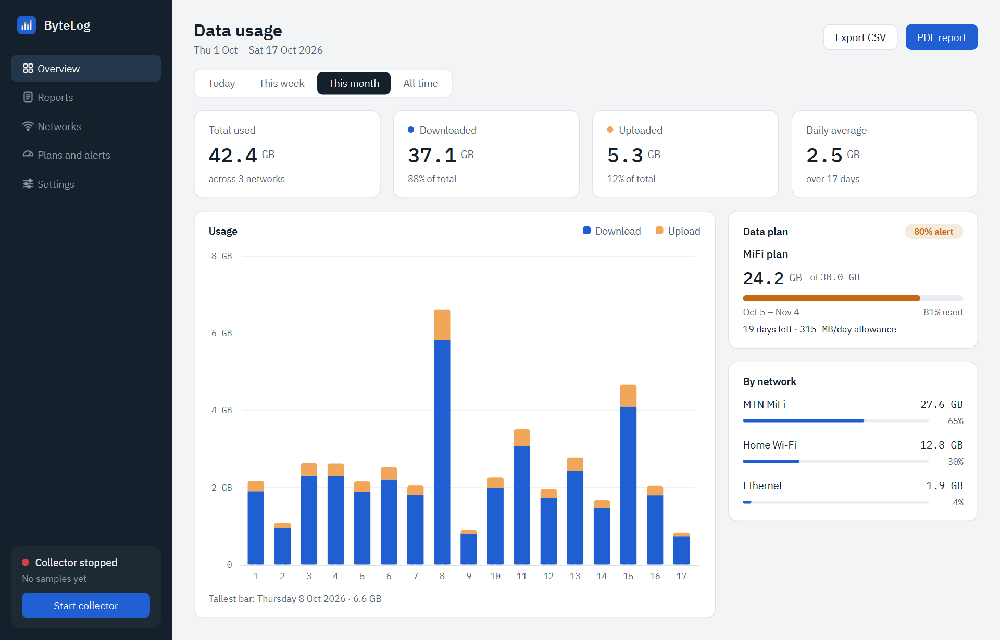

# ByteLog

ByteLog is a desktop app that tracks how much internet data this PC uses. It shows usage for
**Today, This week, This month and All time**, split into download and upload and broken down
**per network** (each Wi-Fi network name or Ethernet adapter). That makes it possible to watch
a metered MiFi or hotspot plan on its own. You can add data plans with a cap and a billing
cycle and get a native Windows alert at chosen thresholds (80% and 100% by default). Reports
export as CSV and PDF.

Everything stays on this PC. There are no accounts, no cloud services and no telemetry.

[](https://github.com/AjabiOladipupo/ByteLog/releases/latest/download/ByteLog-Setup.exe)
[](https://github.com/AjabiOladipupo/ByteLog/releases/latest)
[](LICENSE)



## Install

1. Click **Download for Windows** above, or download `ByteLog-Setup.exe` from the
   [latest release](https://github.com/AjabiOladipupo/ByteLog/releases/latest).
2. Run it. It installs for your user only and needs no admin rights. The installer isn't code
   signed, so Windows SmartScreen may say "Windows protected your PC". Click **More info**,
   then **Run anyway**.
3. ByteLog starts right away and starts again every time you sign in. Open it from the Start
   menu or the tray icon.
4. On Windows 11, turn on **Settings → Privacy & security → Location → Let desktop apps access
   your location**. Without it, Windows hides Wi-Fi network names from apps.
5. Add your data plan under **Plans and alerts**.

Requirements: Windows 10 or 11 (64-bit). If you'd rather not use an installer,
`ByteLog-Portable-win64.zip` on the release page holds the same app as a folder you can
unzip and run.

To uninstall, use **Settings → Apps → Installed apps → ByteLog**. Your usage history in
`%LOCALAPPDATA%\ByteLog` is kept; delete that folder if you want it gone.

## Setup (development)

Requirements: Windows 10 or 11 and [uv](https://docs.astral.sh/uv/). uv downloads Python 3.12
on its own.

```powershell
git clone https://github.com/AjabiOladipupo/ByteLog.git
cd ByteLog
uv python install 3.12
uv sync --all-groups          # creates .venv with runtime, dev (pytest, ruff) and build (PyInstaller) deps
```

Dependencies are managed with **uv**. They are declared in `pyproject.toml` and pinned in
`uv.lock`.

### Run in development

```powershell
# Collector (headless). Ctrl+C to stop, or from another terminal:
uv run python -m bytelog.collector --debug
uv run python -m bytelog.collector --stop

# Dashboard and tray icon
uv run python -m bytelog.ui
```

To develop the UI without waiting for real usage, use demo data in a separate data folder:

```powershell
uv run python scripts/seed_demo.py --data-dir .demo     # 12 months of realistic fake data
uv run python -m bytelog.ui --data-dir .demo
```

`--data-dir` (or the `BYTELOG_HOME` environment variable) works for both processes. The seed
script refuses to write into the real database unless you pass `--force`.

### Tests and formatting

```powershell
uv run pytest
uv run ruff format .
uv run ruff check .
```

The tests run without a real network. They drive the collector with fake counter sequences
covering resets, sleep gaps, clock changes and virtual adapter filtering. They also cover
rollups running twice, period boundaries in several timezones (Lagos, Kolkata +5:30,
Kathmandu +5:45, London DST), billing cycles including short months and leap years, and alert
de-duplication.

## Architecture

```text
src/bytelog/
  platform/    OS layer: Platform protocol (base.py), windows.py, fake.py for tests
  collector/   headless sampler: delta maths, adapter filter, sampler, service loop, alerts
  storage/     SQLite: schema and migrations, settings, repo, rollups, retention, periods,
               billing, plans, models (the shared dataclasses)
  reports/     CSV and PDF export (reportlab; no Qt)
  ui/          PySide6 dashboard: window, sidebar, tray, charts, pages
  assets/      IBM Plex fonts (OFL) and the app icon
scripts/       seed_demo.py, make_icon.py
packaging/     PyInstaller spec, build script, Inno Setup script
docs/          ARCHITECTURE.md (the module contract)
```

ByteLog runs as **two processes** that share one SQLite database in WAL mode at
`%LOCALAPPDATA%\ByteLog\bytelog.db`. Logs rotate in `%LOCALAPPDATA%\ByteLog\logs\`, with one
file per process.

1. **Collector** (`ByteLogCollector.exe`). Task Scheduler starts it at login. It has no
   window. A named mutex ensures only one collector runs at a time. Every 10 seconds
   (configurable from 5 to 60) it does the following:
   - reads all adapters with one native `GetIfTable2` call;
   - computes per-adapter deltas;
   - writes those samples, the new baselines and a heartbeat in one transaction;
   - rolls them up and checks plan alerts.

   Any error in a step is logged, and the loop carries on.
2. **Dashboard** (`ByteLog.exe`). The window and tray icon. It reads the database and writes
   only settings, plans, network labels and metered flags, and adapter include/exclude
   overrides. It asks the collector to **pause**, **stop** or **reset data** by writing
   request keys to `settings`. A named event also wakes the collector instantly on stop.

### What gets counted

- **Adapters.** Only physical Wi-Fi, Ethernet and mobile-broadband adapters are counted.
  Windows marks these as hardware interfaces. A name/description deny-list (in settings) then
  excludes VPN, Hyper-V, WSL, Docker, VirtualBox, VMware, Bluetooth PAN, loopback and
  similar. VPN and virtual-machine traffic already passes through the physical adapter, so
  counting virtual adapters too would count it twice. You can force any adapter in or out on
  the Networks page. Overrides are stored by adapter GUID, so renaming an adapter keeps them.
- **Networks.** A Wi-Fi network is identified by its SSID, read with the native WLAN API, so
  it doesn't depend on the display language. It is read only when the connection changes.
  Ethernet and mobile adapters are identified by adapter.
- **Counter resets** (reboot, adapter disabled and re-enabled, driver reload). A lower reading
  means the counter restarted from zero, so the new reading is counted as bytes since the
  reset. A plausibility cap based on link speed prevents spikes. A delta is never negative.
  The first time an adapter is seen, its reading only sets a baseline.
- **Sleep.** A long gap is recorded as one delta at wake time, flagged and logged.
- **Clock changes.** Timestamps are UTC epoch seconds. Rollups track samples by id, not by
  time, so a clock jumping backwards can't make a rollup skip samples or double-count them.

### Storage

| table | contents | kept |
|---|---|---|
| `samples` | per-adapter deltas, with interval length, local UTC offset and flags | 7 days |
| `usage_15m` | 15-minute UTC buckets per network | 400 days |
| `daily` | local-date totals per network | forever |
| `networks`, `adapters` | detected networks and interfaces, labels, metered flag, overrides | — |
| `plans`, `plan_networks`, `alerts_sent` | data plans, the networks they cover, alerts already sent per cycle | — |
| `collector_state`, `collector_status`, `rollup_state` | baselines, heartbeat, rollup watermark | — |
| `settings`, `meta` | key/value settings, schema version | — |

Rollups are incremental and idempotent: an id watermark advances in the same transaction as
the additive upserts, so running a rollup twice is a no-op. Buckets are **15 minutes**, not
hourly, so the Today chart is exact in timezones with half-hour or 45-minute offsets. Day
boundaries use the system timezone, read through `tzlocal`. Nothing is hardcoded. The schema
is versioned in `meta`, and `storage/schema.py` contains a migration runner.

### Units

ByteLog uses **binary units** throughout: 1 MB = 1024² bytes and 1 GB = 1024³ bytes. Values
under 1 GB are shown in MB; larger values are shown in GB to one decimal place. Plan caps use
the same GB. Some carriers count in decimal GB (10⁹ bytes), and against those ByteLog warns
about 7% early, which is the safe direction.

## Packaging

```powershell
powershell -ExecutionPolicy Bypass -File packaging\build.ps1
```

This builds `dist\ByteLog\` with PyInstaller. One folder holds `ByteLog.exe` (the dashboard)
and `ByteLogCollector.exe` (the collector, which excludes Qt), sharing one set of
dependencies. The script then zips the folder to `dist\ByteLog-<version>-win64.zip`. If Inno
Setup 6 (`ISCC.exe`) is installed, it also builds a per-user installer that needs no admin
rights. The installer adds a Start-menu shortcut, starts the collector and registers it to
start at login.

To publish a release, upload the installer and the zip under stable names, so the README's
download button (`releases/latest/download/ByteLog-Setup.exe`) always points at the newest
version:

```powershell
Copy-Item dist\ByteLog-<version>-setup.exe dist\ByteLog-Setup.exe
Copy-Item dist\ByteLog-<version>-win64.zip dist\ByteLog-Portable-win64.zip
gh release create v<version> dist\ByteLog-Setup.exe dist\ByteLog-Portable-win64.zip --title "ByteLog <version>"
```

Start at login uses a per-user Task Scheduler task (`ByteLog Collector`), created from XML so
that it does not stop on battery or after 3 days. If a policy blocks tasks, an `HKCU\...\Run`
entry is used instead. You can toggle it in Settings.

## Known limitations

- **Wi-Fi names need Location access on Windows 11 24H2 and later.** Without it, Windows hides
  the SSID from apps. ByteLog falls back to the connection profile name, or to
  "Wi-Fi (name unavailable)", and the Networks page links to the setting.
- Traffic from boot until the collector starts at login is still counted, through the
  counter-reset rule. If an adapter is reset again before the collector starts, the traffic
  before that second reset is lost.
- With Fast Startup, "Shut down" doesn't change the boot time. ByteLog relies on counter
  decreases to detect resets, not on boot time alone.
- A delta that spans a sleep, or midnight, is attributed to the moment of waking or sampling.
- Traffic during a pause is deliberately not counted.
- The executables are unsigned, so SmartScreen will warn on first run.
- Toasts can be hidden by Focus/Do Not Disturb. Alerts are still recorded and shown on the
  Overview plan card.

## Roadmap

- Per-application usage. This needs ETW tracing and admin rights; the `platform/` layer and
  the per-adapter sample model leave room for it.
- Syncing usage across several devices (opt-in, local-first).
- macOS and Linux implementations of `platform/`.
- An option for plans whose carrier counts decimal GB.
- Moving the data folder from Settings (a pointer file outside the database).
